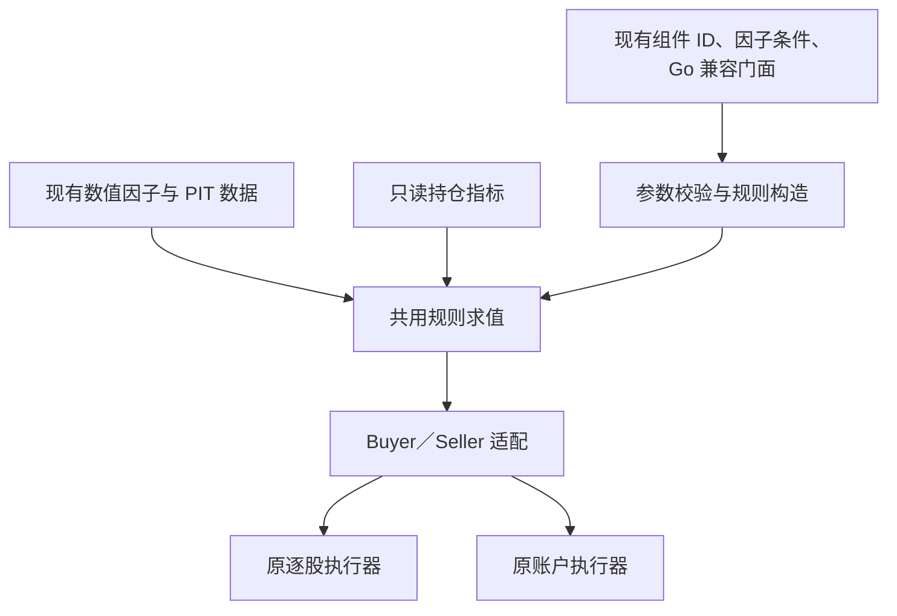

# 因子驱动的统一规则层迁移规划

- 日期：2026-10-17，上海时区。
- 状态：**T7 已知阻塞已修复，合成样本功能与全仓并发复验通过**（2026-10-18）。§9 三项阻塞、本地依赖竞态补丁及后续独立验收发现的 Virtual 期末估值缺陷均已修复。最新全量测试、build、vet、全仓 `-race`、73 组件／734 组接受配置／5,872 组引擎对拍、5000 股分钟负载和 Dockerfile 构建通过；期末估值新增 8 个永久回归场景，上轮两个失败探针均通过。此前分钟规则优化后三轮耗时中位数高约 2.6%，分配次数下降 57%，仍未认定实盘验收通过；详见 [迁移台账](./2026-10-17-factor-rule-migration-ledger.md) §10–§13。
- 源码基线：`261cb71`。执行者必须先比较实际 HEAD 和工作区，保留用户及其他协作者的改动；基线变化时更新盘点和测试记录。
- 部署：代码提交 `69d1371` 已部署至本地 Lab（宿主机 80 端口），页面／API、持久数据与三股票真实行情小样本冒烟通过；回退点与限制见[迁移台账](./2026-10-17-factor-rule-migration-ledger.md) §14。未验证全市场负载、外部 PIT 数据或实盘。
- 用户目标：将买入、卖出判断进一步统一到“因子／持仓指标＋通用规则”，减少重复实现；后续由其他 Agent 执行。
- 本次交付仅为规划。本计划不包含部署、数据迁移、真实行情更新或真实数据回测。

## 1. 完成目标与范围

交付后，Lab 的自由搭建、因子组合及现有买卖组件共用规则求值内核。价格、RSI、MACD 等计算继续复用现有因子；持仓天数、价格收益率、买入后峰值回撤通过独立的持仓输入计算。`Buyer`／`Seller` 继续作为执行器适配接口。

本轮必须完成：

1. 现有 73 个可运行组件逐项进入迁移台账，使用同一数值／规则实现，不在买入与卖出两侧重复写公式。
2. 因子条件、组合条件、持仓规则均能通过现有执行接口运行；历史组件 ID、参数、保存格式、名称及报告快照兼容。
3. 新代码使用共用规则构造能力；旧 Go 组件保留为兼容门面，实际计算和判断委托给共用实现。
4. 盘点并处理目录之外的 Go／脚本／实时服务调用，明确哪些旧入口已迁移、哪些兼容保留及原因。
5. 用旧新行为对拍、两条执行路径各自的交易对拍、历史 JSON 夹具和性能记录证明迁移结果。

本轮不做：合并两条回测执行器、改变交易模型或收益口径、删除全部 `buy`／`sell` 包、扩展公开公式语言、增加表达式编辑器、重做前端、批量重写已保存策略、改变因子研究目录、加入新生产依赖。

**完成不以目录消失为标准。** `cmd/backtest`、实时筛选与 Yaegi 脚本仍引用旧类型，兼容门面可以保留；公式和判断的唯一实现才是本轮统一目标。未迁移的核心组件不得仅靠转调原实现而标记“已统一”。

## 2. 已核实的现状

| 位置 | 当前行为及本轮边界 |
| --- | --- |
| [Factor](../../core/factor.go)、[ContextFactor](../../core/factor_context.go) | 前者输入股票和 K 线，后者补充 AsOf 与 PIT 数据；两者都没有持仓输入。接口保持不变。 |
| [数值因子](../../strategies/factor/) | 已承载价量、均线、RSI、ATR、布林、MACD 等计算；部分窗口因子另有整数价格方法。 |
| [买入组件](../../strategies/buy/)、[卖出组件](../../strategies/sell/) | 仍包含阈值、时序、组合及持仓规则；很多数值计算已经调用因子。 |
| [搭建器定义](../../internal/lab/builder/spec.go)、[组件目录](../../internal/lab/builder/catalog.go) | `group/condition/factor` 三类节点；44 个买入工厂、29 个卖出／风控工厂，共 73 个。现有组支持 AND／OR，独立风控仅接受单条组件条件。 |
| [共用因子条件](../../internal/lab/builder/filter.go) | 验证 kind、版本、区间与零阈值；`Build` 返回 `buy.A因子过滤`，单边界限使用 ±1e9。 |
| [逐股回测](../../core/backtest.go) | `Backtest.Do` 调用 Buyer／Seller；分钟循环会覆写当日 K 线指针，保留历史执行行为。 |
| [账户回测](../../internal/lab/account_backtest.go) | `runAccountBacktest` 统一现金及持仓，逐日先卖后买，卖出使用截至当分钟的独立快照。 |
| [Lab 编排](../../internal/lab/runner.go) | Account 非空走账户路径；旧请求继续使用逐股路径。两条路径保持原有选择方式。 |
| [脚本符号](../../internal/lab/script/symbols.go)、[实时策略](../../cmd/screen/strategies.go) | 仍使用旧买卖类型，不能仅凭 Lab 工厂迁移完毕就删包。 |
| [73 项条件基线](../../internal/lab/testdata/condition_baseline.json) | 已有逐前缀信号哈希；缺省／目录默认值、平价／随机行情等已有覆盖，但不代表非默认参数和分钟情境已覆盖。 |

组件目录还有未开放条目，例如 `SellAt`、`SellRSI`、旧 `SellTPSL`、指数条件与 TopN。它们需要单独盘点，不能因为不在 73 项中就认定无调用或可以删除。

## 3. 术语与架构决策

沿用 [业务词汇表](../../CONTEXT.md) 的“因子、条件、策略、交易信号”定义。研究因子刻画股票在某时点的特征；持仓指标依赖具体一笔持仓，例如相同股票的两笔买入会有不同的持仓天数与价格收益率。



### 3.1 包边界

建议只新增一个跨调用方可复用的 `strategies/rule/` 包；执行 T1 时按最小 API 落地，先不建立插件系统、动态注册系统或持仓因子研究目录。

- `strategies/factor/`：已有股票因子与纯数值计算。新数值只有确实可用于股票研究、且遵守现有契约时才放入此包。
- `strategies/rule/`：通用比较、已有组合／时序原语、只读持仓指标和 Buyer／Seller 适配。持仓指标不自动注册到研究用 `factor.Catalog`。
- `strategies/buy/`、`strategies/sell/`：保留既有类型、字段、Name、Children 和接口，逐批改为调用共用规则能力。删除重复实现，不制造第二套规则逻辑。
- `internal/lab/builder/`：继续负责组件 ID、参数解码、角色及树规模验证、旧配置到执行规则的构造；现有工厂可以返回已迁移的兼容门面，不要求为了消除一次转发新增第二套工厂。
- 两条回测执行器：继续调用原接口，只提供已有行情前缀和买入信息。通过适配器派生持仓指标，不向执行器硬塞止盈止损判断。

依赖方向必须是 `buy/sell → rule → core、factor、extend、researchdata`，不得由 rule 反向导入 buy、sell、根包 common 或 internal/lab。common 已导入 buy／sell，反向引用会形成循环。PIT 数据由调用方注入，rule 不读取全局 common.ResearchData、不初始化数据库、不联网。

### 3.2 最小求值输入

以下是职责草案，不是要求照抄的最终公开接口：

| 输入 | 来源与要求 |
| --- | --- |
| 股票代码与可见 K 线前缀 | Buyer／Seller 原参数；只读，不能取当前前缀之后的数据。 |
| AsOf | 从本次可见快照取得；保留现有 FactorContext／BindContextFactor 的时点语义，不用系统当前时间。 |
| PIT 数据 View | 沿用调用方已绑定的数据视图；可直接复用 core.Contextual、BindContextFactor。 |
| 买入信息，可为空 | Seller 原本持有的 core.Buy；买入规则无持仓时明确不可用，不能伪造买入价或时间。 |

现有输入足以计算本轮所需的价格收益率、交易日计数和历史峰值。净浮盈、账户现金、可用资金等需要额外成本或账户输入，本轮不添加、不伪装成已有持仓指标。

### 3.3 原语与兼容门面

优先实现实际迁移需要的比较、区间和 AND／OR。按组件批次补充历史引用、交叉、连续段和窗口判断；不一次性造全套算术 DSL。板块、ETF、显式全部买入等属于代码分类或基准谓词，可作为小型原生谓词保留，不强行制造无研究意义的 0/1 因子。

新规则在构建阶段完成校验。旧结构体门面不能为保存编译结果而擅自改字段；可按值构造轻量规则，但不能在每次 Buy／Sell 时解析 JSON、扫描全目录或重建解释器。名称格式由既有合同决定，不因共用内核而变成泛化表达式字符串。

`FactorFilterSpec.Build()` 的既有返回类型也要保留；可让 `buy.A因子过滤` 内部委托共用比较。不能先改返回签名，再通过全仓替换掩盖 Go API 兼容性变化。

### 3.4 无效数据与逻辑组合

- 保留 NaN 与真实 0 的区别，未定义值不能补 0 后参加比较。新比较规则对非有限输入不触发；旧组件在这些边界上的行为必须先由 T0 记录。
- 已有 OR 中，另一条有效条件成立时仍可成立，例如“因子缺数据 OR 显式全部买入”；不能新增“任一叶缺数据整棵树失败”的全局规则。
- 当前搭建器不支持 NOT，本轮不扩展保存格式增加 NOT。旧 Go `buy.Not` 是直接反转布尔值，包含“子条件因无数据返回 false 后被反转”的既有行为，迁移不能悄悄改变。
- 若通用无效值规则与某个旧组件冲突，先保持该项原路并在台账中标记阻塞，给出复现和独立的行为变更方案；不能加隐式兜底、删除测试或更新哈希求绿。该项未解决之前整批不能宣称完成。
- 新构建的空组拒绝；显式全部买入和 HoldToEnd 保留。已有 Go 组合子的空切片、nil 子项、短路顺序、Name／Children 结果也必须对拍。

## 4. 持仓与时序语义：执行前必须锁定

| 规则或边界 | 需要保留的具体语义 |
| --- | --- |
| 持仓天数 | 按原实现的交易日索引计数，不按自然日；找不到买入日、重复日期、首次匹配与逆序匹配等须分别盘点，不能先统一定位算法。 |
| 收益类规则 | 使用原始买入价或原有公式；名称、UI 百分数与内部比例分别核对。价格浮盈不能改称扣费净收益。 |
| `A止盈止损` | 当前扫描买入日之后直到当前前缀的历史区间；换成“仅当前浮盈达阈值”会改变回撤后再次求值的结果。需要等价的窗口存在判断。 |
| `A追踪止损` | 当前峰值使用买入日（含）之后的最高收盘价，不是最高价 High；最后一天可能是当前分钟快照。Drawdown=0 的 Name 与执行默认并不相同，迁移按事实保留。 |
| ATR／移动止盈／买入价防线 | 每个公式、激活门槛、峰值口径、买入日开盘价来源和次日限定分别建例子，不能套用同一“当前收益率”替代。 |
| 买入后 MACD 连跌 | 股票时序与持仓天数同时参与；属于持仓批次，不能只迁移 MACD 数值后漏掉买入后限制。 |
| 尾盘持仓卖出 | 保留上海／原本时区的时间比较、原交易日计数以及快照 00:00:00 时的日线退化语义。 |
| 时间引用 | “上一根”按交易日索引。计算过去某日的因子时同时截断 K 线并回退 AsOf，不能拿今天的 PIT 视图填过去值。 |
| 窗口与精度 | 均量是否含今日、前期高点是否排除今日、RSI 整数／浮点口径、MACD 原始柱及预热期保持一致；既有 Price 整数比较不能统一转浮点后损失厘级边界。 |
| 参数默认值 | nil／缺省／显式 0／目录默认不是一回事；Max=0 或 Max<Min 的历史退化语义和 ±1e9 单边界限保留。 |

两条引擎分别做迁移前后对拍，不要求它们彼此交易相等：逐股路径与账户路径的同日买卖顺序、全局资金约束、跨年持仓和 Virtual 费用口径不同。账户期末估值不扣虚构卖出费；旧逐股 Virtual 保留原结算方式。

当前源码中 `Backtest.Do` 的指针覆写行为与 PROJECT_RULES 的“禁止修改原始 dks”条文存在差异。此处仅登记事实，本计划不修改该引擎或借迁移修复此问题；测试继续依赖 researchrun 的隔离和现有引擎差分基线。若后续确实需要改引擎，应独立提出范围与依据。

## 5. 契约与数据兼容

1. **核心类型保护**：不增删或改名 Buyer、Seller、Buy、Trade、Backtest、PositionConfig、Cost 等受保护字段与方法。若执行中发现无法沿用，必须先提出具体签名、调用方及数据影响，取得用户确认后才能落地；本文不是这类结构修改的预先授权。
2. **策略 JSON**：保持 BuilderSpec version=1、现有三种节点和 FactorFilterSpec 字段；不序列化内部规则对象或包路径。严格解码、角色检查、8 层／64 节点边界继续生效。
3. **参数及版本**：保留 ParamDef 单位与 ratioArg 等转换，避免百分数二次除以 100；因子版本漂移继续拒绝，旧版本=0 的兼容逻辑保持。不得自动升级候选或因子实现版本。
4. **持久化**：读取、编辑、保存、另存为及版本冲突沿用现有协议。启动、加载和回测不批量重写 data/lab/strategies，不修改旧报告、候选或冻结研究产物。
5. **风控角色**：独立风控继续是任一触发、优先于策略卖出信号，最终通过 Seller 适配；不开放用户自定义任意组合风控，不把持仓源放进买入或研究目录。
6. **展示与历史报告**：组件 ID、中文名称、默认参数展示和报告规则树保持；报告展示冻结快照，不读取新策略重算说明。研究用因子目录不因内部迁移自动增加条目。
7. **旧调用方**：common 的策略、cmd/screen、旧 MACD API、core.Diagnoser、研究执行层、脚本符号与测试夹具都列入检查。`cmd/backtest/main.go` 仍是受保护草稿，不顺手改写；通过兼容门面使它继续编译并保留交易行为。

## 6. 可交接的实施任务

所有任务初始状态为 `[ ]`。默认依次执行，完成一项再进入下一项；后续确需多个 Agent 时按明确文件归属划分，禁止并行改写目录、版本协议和基线夹具。

### T0 `[x]` 全量盘点与基线冻结

- 依赖：无。读取 AGENTS、PROJECT_RULES、MEMORY、本计划和实际 HEAD。
- 新建迁移台账 `docs/plans/2026-10-17-factor-rule-migration-ledger.md`，为附录 73 个 ID 各建一行。字段：角色、旧类型／方法、参数单位、默认／零值、公式及引用窗口、预热、无效输入、持仓依赖、当前调用方、目标原语、测试证据、状态。
- 另列所有未入目录但仍有引用的导出类型、脚本符号、组合子和旧接口；按“迁移／兼容保留／无引用待删／需单独变更”分类。完整 rg 检索之后才能判定死代码。
- 保存新旧对拍夹具，覆盖非默认参数及反例。参考原实现的测试内快照可作为迁移期 oracle，生产代码不保留双份完整实现；预计删除时机写入台账。
- 跑当前全仓测试、构建与前端现有测试，记录实际结果及环境。保留 condition_baseline 和 macd_shape_baseline，不重新生成它们。失败先区分已有失败和本次规划之外的问题。
- 验收：73/73 已盘点；未入目录项有明确分类；执行前基线可复现。没有这些证据不得启动大批量替换。

### T1 `[x]` 共用内核与执行接口适配

- 依赖：T0。主要范围：新增 `strategies/rule/` 及其测试；必要的纯数值补充仅放在现有 factor 包。
- 固定最小求值输入和 Value／Rule 构造方式，先实现比较、区间、AND／OR、显式常量谓词与 Buyer／Seller 适配；保留整数价格比较能力。
- 通过现有 Contextual／BindContextFactor 接入 PIT，避免平行发明数据访问接口。只在 T3 真正需要时添加时序操作，不引入字符串公式解析器。
- 单测：阈值相等、0／缺省、负值、NaN／Inf、空前缀、非法区间、AND／OR 短路、无持仓的持仓求值、同一规则跨代码／持仓的隔离。
- 验收：内核不依赖 common、buy、sell、lab；两个适配器满足原 core 接口；尚未切换业务路径时全量基线不变。

### T2 `[x]` 基础比较批次，40 项

- 依赖：T1。ID 清单见附录 A，分数值族逐个提交，不按文件名整仓替换。
- 将阈值、因子间比较及普通组合交给共用内核，复用已有 factor 实现；保留板块／ETF／全部买入等明确原生谓词。
- 同步对应旧 Go 门面与因子区间过滤，保留类型、字段和 Name。参数归一只能有一个来源，构造器与门面不分别复制公式。
- 每个 ID 对拍：nil 参数、目录默认、至少一个非默认值、阈值相等、预热前后一根、空／平价／零量行情、股票代码类别。
- 验收：本批 40/40 台账有独立证据，73 项旧哈希保持，未迁移组件继续原路；新增规则不能只是包一层旧完整算法。

### T3 `[x]` 时序批次，19 项

- 依赖：T2。ID 清单见附录 B；主要范围为 temporal／MACD／窗口规则及相应旧门面。
- 复用现有 MACD Series、连续段和窗口因子，按已确认语义补充最少的历史引用、交叉、连续段／窗口判断。每次调用只看给定前缀。
- 对拍交叉相等、连续天数上下限、断点、历史极值是否含今天、多个局部反转、最短预热、自定义 MACD 参数。不能将事件判断降为当前单值阈值。
- 加入前缀稳定性测试：追加未来行情不改变过去的求值；PIT 历史引用使用过去的 AsOf。对末根 K 线原地变化后重新求值，不能误用旧缓存。
- 验收：19/19 明细及旧新行为一致；不引入按切片地址、长度或股票代码跨调用缓存；自定义参数和原计算顺序保留。

### T4 `[x]` 持仓批次，14 项

- 依赖：T3。ID 清单见附录 C；新增只读持仓指标可位于 rule 包，保持 Factor／FactorContext 不变。
- 按第 4 节逐项拆分历史扫描、持仓计数、价格收益、峰值回撤与时刻判断，不用一个当前收益率替代所有退出规则。
- 单测同股不同买入日／价、买入日缺失、重复日期、买入当天、次日、周末间隔、跨年、回撤后恢复、阈值相等、缺分钟退化及尾盘边界。输入与原始 K 线不得被规则修改。
- 相同持仓组装后分别交给原逐股执行器与原账户执行器，对每条路径比较迁移前后的成交时间、价格、数量、费用和 Virtual；不拿两个引擎的差异当迁移失败。
- 验收：14/14 行为对拍通过；独立风控仍经 Seller 执行，账户资金逻辑没有进入 rule，原有风控优先级与 T+1 保持。

### T5 `[x]` Lab 编译、保存与快照收口

- 依赖：T2～T4 全部完成。主要范围：builder/spec.go、catalog.go、filter.go、strategy_spec.go 及对应测试。
- 确认普通 condition、factor、组合组、独立风控及因子组合最终共用同一内核；逐项移除仍存在的重复求值实现，避免 ID→公式在两处维护。
- 沿用既有 JSON，不为内部规则树升级 schema。严格校验、树规模／角色、版本漂移、原子保存与乐观锁继续有效。
- 测试旧 JSON 读写、零阈值、旧组件名称与 ID、混合因子／组件树、显式全部买入、HoldToEnd、复制／冲突、回测草稿快照、历史报告读取。
- 验收：73/73 可运行，组件目录与研究因子目录合同未变；前端无需新增表达式编辑器。仅因合同测试发现问题才局部改前端，涉及 UI 时读取该区域设计规则并做桌面／窄屏验证。

### T6 `[x]` Go、脚本及实时服务兼容收口

- 依赖：T5。主要范围：旧 buy／sell 门面、script 符号、common 装配及 cmd/screen；保护 cmd/backtest 草稿。
- 按 T0 的未入目录台账迁移仍在维护的可兼容算法，保留 Go 类型方法集、组合子 Children、名称和脚本符号；所有旧名调用委托同一共用实现。
- TopN 继续使用现有横截面快照与组合研究路径。SellAt／SellRSI 的扩展签名和已知不同语义的旧 SellTPSL 不自动转换或删除，明确列为旧接口兼容例外，不计作已统一。
- 已无引用的私有算法和重复帮助函数可删除；旧公开类型只有在仓库调用、脚本符号及用户已保存脚本兼容性均有证据时才提出独立删除决定。
- 验收：每个未入目录项有归属和证据；Go 构建、诊断、实时规则离线样本、Yaegi 原生对拍通过；buy／sell 包保留必要门面且无新规则逻辑分叉。

### T7 `[x]` 最终验收与交接

- 依赖：T6。补齐第 7 节测试矩阵、完整命令结果、性能基线、台账和正式指南。
- 检查重复生产算法是否真正删除、所有旧 ID 是否映射、持仓指标是否误入研究目录、是否新增隐式回退、是否意外改动真实数据／冻结产物。
- 更新本计划状态，列出真实完成项、旧接口兼容例外及仍需独立授权的事项。将可复用的长期约定合并到 MEMORY，不记录未经验证的实现设想。
- 验收：所有核心任务完成、73 项无未迁移或静默降级；受保护接口及持久格式未变；完整验证通过或有明确可接受的环境限制。用户未要求时不部署、不推送。

## 7. 验证矩阵与命令

| 层级 | 必须保留／补充的证据 |
| --- | --- |
| 数值与规则 | 每个新分支至少有边界测试；精度、单位、预热、输入不可变及无效数据；原 factor 测试保持。 |
| 原组件信号 | `TestConditionFactorEquivalence`、condition_baseline、MACD 形态基线；另补非默认参数和手写边界预期，不能只依靠哈希。 |
| 组合与因子条件 | `TestBuilderFactorConditionsShareStrategyRules`、混合树、组合顺序、独立风控及缺省参数；旧 Go Not 单列。 |
| 逐股执行 | `core/backtest_equiv_test.go` 的 `TestDo与逐日参考实现等价`（参考仅校正 T+1），以及同一逐股引擎下旧／新规则交易对拍；多持仓 T+1 和行情不可变由独立预期测试覆盖。 |
| 账户执行 | `TestAccountCashBudgetLotsAndDailyValuation`、先卖后买、资金不足、跨年、缺日／分钟、Virtual 与取消；补同一账户引擎下旧／新规则对拍。 |
| 保存及报告 | `TestBuilderDraftRunAndSnapshotIsolation`、`TestBuilderFactorRunKeepsFrozenSnapshot`、账户报告往返、历史报告与策略 JSON 夹具。 |
| 兼容入口 | `TestBuilderTemplateTradesMatchCLI`、MACD 默认规则对拍、Yaegi 的 LoadScript／BuyerParity、实时筛选与 Diagnoser 的离线输入。 |
| 性能 | 相同固定输入、参数和环境记录耗时／分配；覆盖分钟卖出热循环与多个变体／同股不同持仓。出现明确退化先定位，不靠跨调用缓存掩盖。 |

建议每批运行受影响测试，T0 和 T7 跑全仓。下面命令为未来执行清单，**本次文档编写未运行它们，也不将历史通过结果当作实施通过**：

```bash
# Linux / Go 1.25.4+，上海时区；测试仅使用临时数据。
TZ=Asia/Shanghai go test ./... -count=1
go build ./...
go vet ./...
node --test internal/lab/web/*.mjs
python3 tests/deploy_test.py
git diff --check
```

macOS 的既有 goutil 依赖缺少实现时，使用本地已有的 Linux Go 镜像和缓存；按 MEMORY 中的 Docker 约定执行，优先禁网。首次引入共享规则后，环境支持时补竞态检测；不支持时写明未检查及原因，不能修改或跳过有效测试求绿。保持代码修改前后的实际结果，不在未经验证时更新原基线哈希。

## 8. 分批切换与退出条件

每批以“新增共用实现和测试 → 与旧算法对拍 → 切换该批工厂／门面 → 删除该批重复实现”完成闭环。未迁移的 ID 继续明确使用原路径，不设运行错误时自动回退旧实现的开关；已经迁移的规则若编译失败，在启动任务前返回错误。

复原优先撤回本批代码提交，不修改真实策略文件、旧报告或研究证据。测试内保留的旧 oracle 在最终对拍完成后清理或精简为最小反例，不能把双实现永久部署到生产。

遇到以下情形，执行者应停止扩大改动、给出最小证据与选择：需要改受保护核心类型；旧规则与新语义确实不等价；需要批量改写用户数据；需要新生产依赖；需要合并执行器；需要修改 cmd/backtest 草稿。普通包内结构、测试夹具和可逆实现细节无需逐项审批。

## 9. 给后续 Agent 的执行提示

可将以下内容作为后续任务提示，附上本文件：

> 执行 docs/plans/2026-10-17-factor-rule-unification.md。先读取项目规则与当前源码，确认 HEAD 相对 261cb71 的变化，从 T0 开始，默认按依赖顺序推进。先冻结逐项语义和迁移前基线，再写共用内核及测试。保持现有因子、Buyer／Seller、保存 JSON 和两个执行器的行为边界；本轮不合并执行器、不删除全部 buy／sell 包、不自动迁移真实数据。不要为通过测试重写旧哈希。每批完成台账、调用方和验证，报告已完成项、真实测试结果及例外；需要改变受保护接口或扩大范围时先说明证据并等待决定。不要部署、推送或向其他聊天发消息，除非用户后续明确要求。

以下附录为基线分类，T0 应复核实际实现后允许在批次之间调整归属，但必须维持 73 个 ID 恰好覆盖一次。分类是工作分组，不代表其中所有语义已验证。

## 附录 A：T2 基础比较（40 项）

- `buy_all`
- `buy_board_cyb`
- `buy_board_kcb`
- `buy_board_bj`
- `buy_etf`
- `buy_price`
- `buy_market_cap`
- `buy_price_above_ma`
- `buy_close_above_ma`
- `buy_ma_bull`
- `buy_rsi_low`
- `buy_rsi_range`
- `buy_volume_surge`
- `buy_volume_double`
- `buy_volume_shrink`
- `buy_turnover_min`
- `buy_limit_up_hit`
- `buy_filter_limit_up`
- `buy_close_gt_prev_close`
- `buy_close_gt_prev_open`
- `buy_break_high`
- `buy_solid_bull`
- `buy_solid_bear`
- `buy_day_gain_range`
- `buy_atr_range`
- `buy_boll_lower`
- `buy_boll_lower_volume`
- `buy_boll_lower_rsi`
- `buy_bias_oversold`
- `buy_zscore_oversold`
- `buy_donchian_lower`
- `sell_back_to_ma`
- `sell_rsi_overbought`
- `sell_rsi_recover`
- `sell_back_to_boll_mid`
- `sell_bias_zero`
- `sell_zscore_zero`
- `sell_back_to_donchian_mid`
- `sell_big_fall`
- `sell_volume_big_bear`

## 附录 B：T3 时序（19 项）

- `buy_stand_above_ma`
- `buy_ma_up`
- `buy_pullback_ma`
- `buy_macd_negative`
- `buy_macd_rising`
- `buy_macd_positive`
- `buy_macd_reversal`
- `buy_macd_golden_cross`
- `buy_macd_above_zero`
- `buy_rsi_turn_up`
- `buy_rsi_oversold_rebound`
- `buy_recent_gain_below`
- `buy_bottom_up`
- `sell_macd_reversal`
- `sell_macd_dead_cross_negative`
- `sell_break_ma`
- `sell_below_short_ma`
- `sell_ma_dead_cross`
- `sell_long_ma_down`

## 附录 C：T4 持仓（14 项）

- `sell_macd_down_after_buy`
- `risk_takeprofit_stoploss`
- `risk_fixed_stop`
- `risk_trailing_stop`
- `risk_atr_stop`
- `risk_profit`
- `risk_fixed_tp`
- `risk_trailing_takeprofit`
- `risk_atr_takeprofit`
- `risk_holding_days`
- `risk_holding_days_tail`
- `risk_break_buy_price`
- `risk_no_gap_up`
- `risk_break_buy_open`
